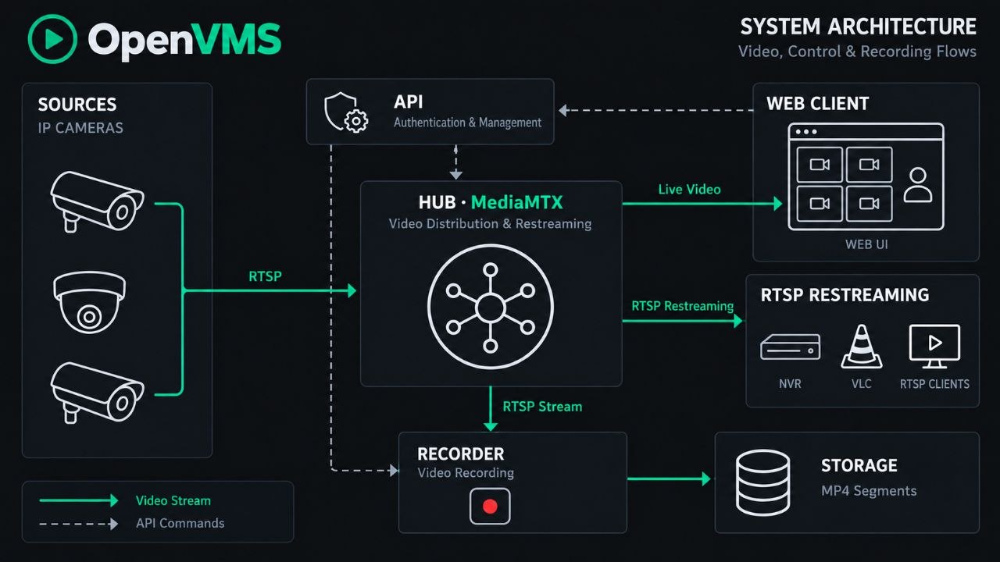

# OpenVMS

A self-hosted video management system for IP cameras. Watch live, record,
review recordings and restream — all in one lightweight package you run on
your own server.

## Key features

- **Live view.** A videowall of any number of cameras in a resizable grid.
  Drag cameras onto the wall, resize cells and save layouts.
- **Recording.** Each camera records continuously, or only when it sees
  motion. Recordings are stored as standard MP4 segments with a timeline
  index that knows where the gaps are.
- **Recording player.** Browse any day on a timeline, jump between
  recordings, change playback speed, and export a period as a downloadable
  MP4.
- **RTSP restream.** Every camera gets its own RTSP address that third-party
  VMS software, NVRs or analysis tools can consume directly.

## Why it stands out

- **Simplified camera addition.** OpenVMS finds cameras by scanning an IP
  range or through ONVIF discovery, and a short wizard finishes the job.
  Credentials are stored encrypted, never in plain text.
- **Built-in PTZ control.** Pan, tilt, zoom and saved presets for PTZ cameras
  live right in the videowall cell. No vendor software needed.

## Architecture

One hub opens a single connection to each camera and restreams it to every
consumer: the live view, the recorder and third-party RTSP clients. The
camera only ever sees one client, so its load and the network traffic stay
flat no matter how many people are watching. Streams start on demand —
nothing pulls a camera when nobody is watching it.



## Installation

Use a Docker daemon on `linux/amd64`. The CPU and GPU images do not support
other platforms.
Use the Docker Compose plugin, version 2.24.4 or later, with support for
`!reset` and `--pull never`.

The installer downloads OpenVMS images from the GitHub Container Registry
(GHCR) by digest. It does not build images on the host. It downloads all
images before it starts the services.

Download the installer outside the installation directory.

```bash
curl -fsSL -o openvms-install.sh https://raw.githubusercontent.com/LeonardoDiasRR/open-vms/main/install.sh
```

Run one of these commands.

| Command | Variant selection |
| --- | --- |
| `bash openvms-install.sh` | `OPENVMS_VARIANT=auto` (default). The installer uses the GPU image if the NVENC test passes. |
| `OPENVMS_VARIANT=cpu bash openvms-install.sh` | The installer uses the CPU image and skips the GPU test. |
| `OPENVMS_VARIANT=gpu bash openvms-install.sh` | The installer requires the GPU image and stops if the NVENC test fails. |

GPU mode requires a GPU with NVIDIA NVENC support, a compatible NVIDIA
host driver, and the [NVIDIA Container Toolkit][nvidia-toolkit] configured
for Docker. The installer tests NVENC by encoding a short H.264 video in
the GPU image. `nvidia-smi` alone does not confirm that NVENC works.

For a new installation in `auto` mode, the installer uses the CPU image
only if it finds that GPU encoding is unavailable. The log gives the
reason. A Docker or registry error does not cause a switch to CPU.

[nvidia-toolkit]: https://docs.nvidia.com/datacenter/cloud-native/container-toolkit/latest/install-guide.html

### Installation settings

The default installation directory is `/opt/openvms`. The installer creates
`.env` with a random database password if that file does not exist.

- Set `OPENVMS_INSTALL_DIR` to change the installation directory.
- Set `OPENVMS_REF` to select a compatible Git reference for a new checkout.
  Use the installer from that reference.
- Set `OPENVMS_MEDIA_DIR` before installation to change the recording
  directory. The default is `<install-dir>/archive/`.

Use a local file system for the recording directory during installation.
To use an NFS share, mount it on the host. Set `OVMS_MEDIA_PATH` in `.env`
to the mount path. Set the directory permissions to let the container
write to the share. With NFS root squash, mode `700` can prevent writes.

The image sets the playback preview option at build time. The installer
stops before startup if `OPENVMS_PLAYBACK_PREVIEW` does not match
`OPENVMS_IMAGE_PREVIEW` in `deploy/images.env`.

### First sign-in

Open `http://<host>:7102`. Sign in as `admin` with the initial password
`admin`. Set a new password when prompted.

The web interface uses HTTP. Configure HTTPS before you expose it to the
Internet. PostgreSQL listens on the host only at `127.0.0.1:55433`.

### Existing installations and recovery

The installer does not update an existing checkout. Update an older
checkout manually to a compatible release before you run the installer.

The installer does not migrate an active installation that uses a local
build. Schedule a separate maintenance window for that migration.

For an existing GHCR installation, the installer keeps the installed
variant and image digest or stops. It does not switch an existing GPU
installation to CPU if the NVENC test fails. It does not refresh the
PostgreSQL, Nginx, or MediaMTX image tags. It does not replace existing
containers. If the original `.env` or a required container is missing,
restore it before you run the installer again.

Keep the Git history for the revision in `deploy/images.env`. The installer
checks that the source and Compose files match the release. Keep credentials
and the recording path in `.env`. Do not override them in the shell.

If a step fails, check the phase, exit code, and log path in the installer
output. Each run writes a log under
`${XDG_STATE_HOME:-$HOME/.local/state}/openvms/`. The installer log does
not include container logs or the rendered Compose configuration.

If startup fails, check the containers before you run the installer again.
Startup can change containers before a health check fails. Correct the
cause of the failure. Run the installer again in the same directory.

Keep `.env`, `conf/`, the key in the `ovms-data` volume, the database
volume, and the recordings. Do not use `docker compose down -v` for
recovery. The installer does not roll back database changes.

To change a timeout, set its variable to a positive integer in seconds.

| Variable | Default (seconds) | Phase |
| --- | ---: | --- |
| `OPENVMS_PULL_TIMEOUT` | 900 | All image downloads and any retry combined |
| `OPENVMS_START_TIMEOUT` | 300 | Service startup |
| `OPENVMS_HEALTH_TIMEOUT` | 180 | Health checks after startup |

### Compose maintenance

Run the commands from the installation directory. Use the same Compose
project name as the installer. Find the selected image digest in the
installation log. Compare it with the full references in
`deploy/images.env`: `OPENVMS_IMAGE_CPU` for CPU or `OPENVMS_IMAGE_GPU`
for GPU. Use the exact full reference for the digest in the log, not a tag
or the digest from a newer release.

In Bash, paste that full reference at the prompt. For GPU, remove the `#`
from the line that adds the NVIDIA Compose file.

```bash
read -r -p 'Full image reference: ' OPENVMS_IMAGE
export OPENVMS_IMAGE
compose=(docker compose -f docker-compose.yml -f deploy/compose.ghcr.yml)
# compose+=(-f deploy/compose.nvidia.yml)

"${compose[@]}" config --quiet
"${compose[@]}" ps -a
"${compose[@]}" logs --tail=100 api
```

To start or recreate services, validate the configuration first. Download
the images before you run `up`. Use the same Compose command and image
reference:

```bash
"${compose[@]}" config --quiet &&
  "${compose[@]}" pull &&
  "${compose[@]}" up -d --no-build --pull never
```

### Local builds for development

Use `docker compose -f docker-compose.yml build` for local development
only. Do not use a local build to maintain a GHCR installation.

## Known limitations

Use Chrome. Other browsers need an extension or specific hardware to decode
H.265 camera streams.
